# SmartHire 2.0 — Resume Intelligence & Job Matching Platform

[](https://www.python.org/)
[](https://fastapi.tiangolo.com/)
[](https://react.dev/)
[](https://www.typescriptlang.org/)
[](https://tailwindcss.com/)
[](https://playwright.dev/)
[](https://pytest.org/)
[](https://vitest.dev/)
[%20%7C%20Postgres%20Ready-blue.svg)](https://alembic.sqlalchemy.org/)

> **Classical Machine Learning Architecture Notice:**  
> SmartHire runs entirely on deterministic, classical machine learning and natural language processing techniques — including **TF-IDF Vectorization, Logistic Regression, Linear Support Vector Machines (SVM), Cosine Similarity, K-Means Clustering, PCA, and Non-Negative Matrix Factorization (NMF)**.  
> **No Generative AI or Large Language Model (LLM) APIs are used.** The platform operates with zero API costs, deterministic sub-15ms inference latency, zero hallucinations, and complete mathematical transparency.

---

## 📌 Executive Summary

**SmartHire 2.0** is an enterprise-grade recruitment intelligence platform that bridges candidates and recruiters through transparent, auditable natural language processing. 

Unlike opaque generative AI wrappers that hallucinate candidate qualifications and incur external API costs, SmartHire 2.0 is built on mathematical feature extraction and classical supervised/unsupervised machine learning. It provides:
- **For Candidates:** Instant resume parsing across multiple formats (`.pdf`, `.docx`, `.txt`), automated domain category prediction, regex-verified technical skill extraction, job recommendations ranked by cosine similarity, a transparent 3-factor compatibility index, and resume portfolio management.
- **For Recruiters:** An executive command center dashboard, candidate pipeline review with automated PII masking (`[EMAIL MASKED]`, `[PHONE MASKED]`), one-click candidate triage (Shortlist / Decline), and immutable compliance audit logging.
- **For Systems & Security:** Role-based access control (RBAC) via JWT tokens, collision-resistant SHA-256 private document storage, a 24-hour guest resume lifecycle retention worker, and Alembic database migrations.

---

## 🏛️ System Architecture

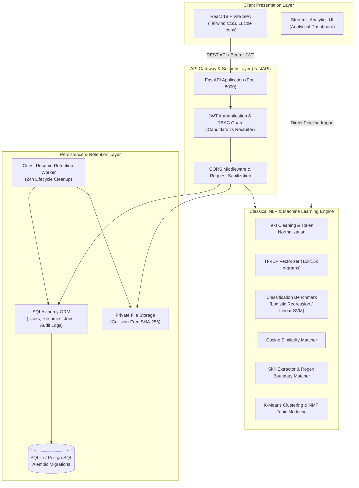

---

## 📸 Visual Showcase (Actual Application Captures)

All screenshots below are authentic visual captures taken by Playwright real-browser automation against the running SmartHire 2.0 application using synthetic test data. For capture instructions and the full image catalog, see **[`reports/screenshots/README.md`](reports/screenshots/README.md)**.

### 1. Candidate Experience & Theme Support

| Light Mode (First-Time Welcome) | Dark Mode |
|---|---|
| 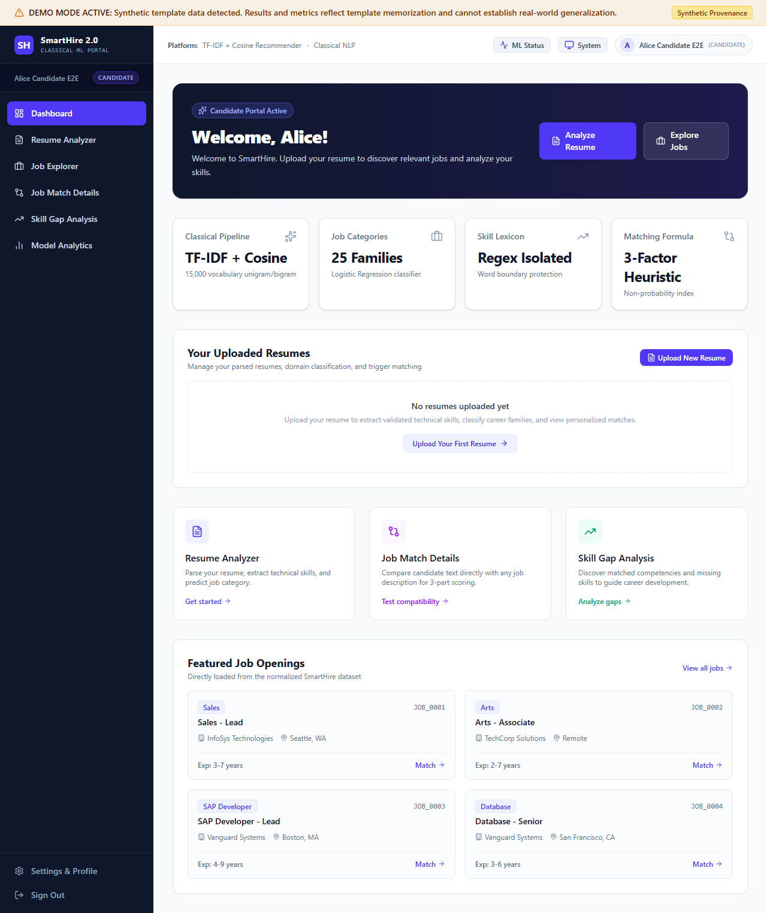 | 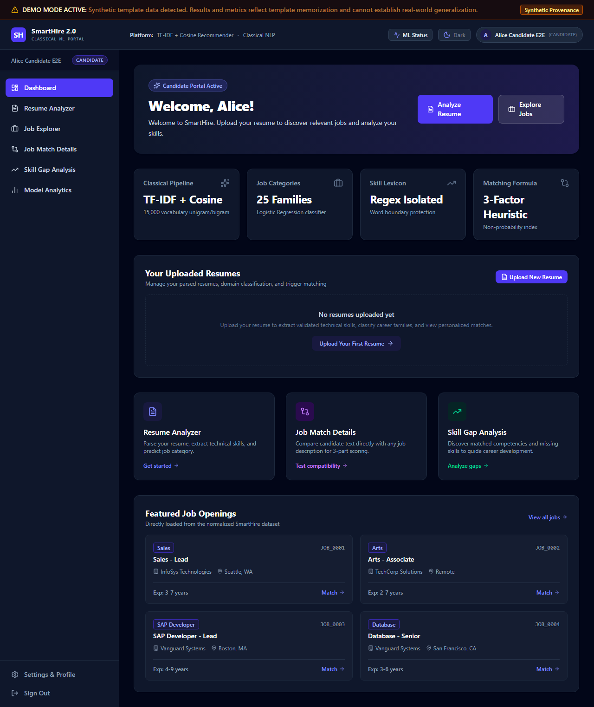 |

> **Dynamic Onboarding vs. Returning Experience:**<br/>
> First-time logins display personalized onboarding guidance (`Welcome, {first_name}!`), while returning users receive analytical system summaries (`Welcome back, {first_name}!`), as demonstrated in the returning session capture below:

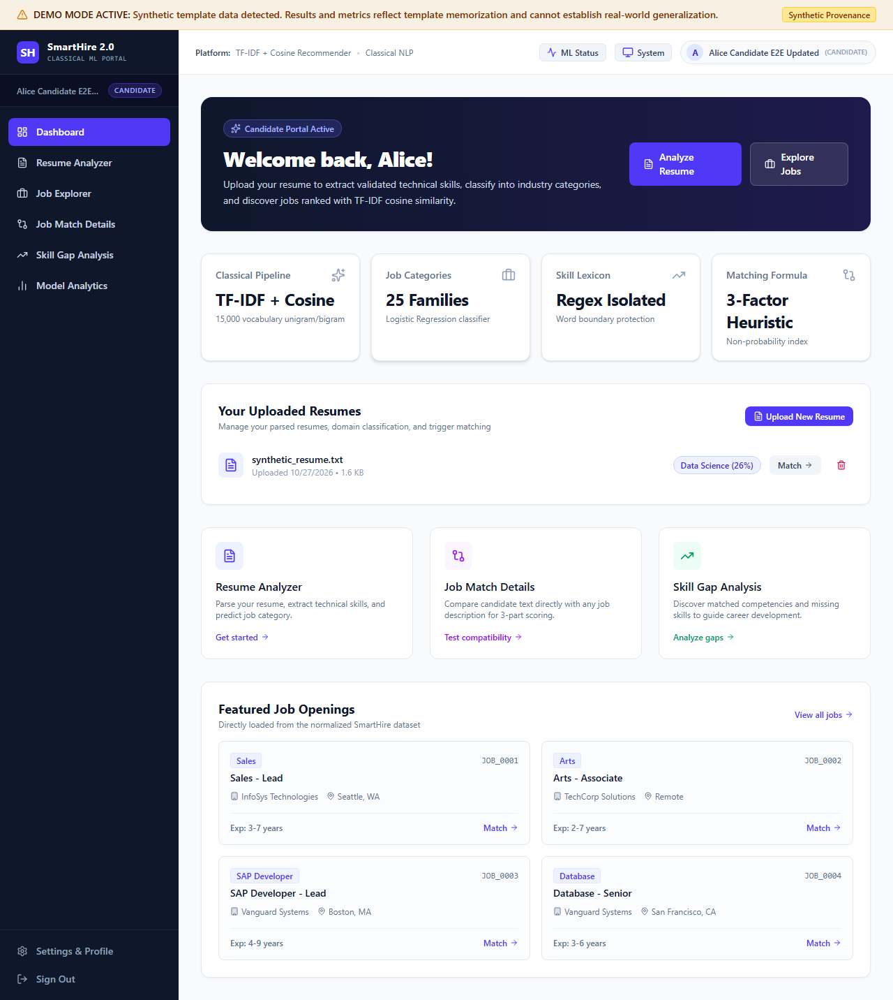

---

### 2. Resume Parser & Classical NLP Classifier
Uploads resumes in `.pdf`, `.docx`, or `.txt` format, generates a SHA-256 collision-resistant fingerprint, predicts the domain category with model confidence, extracts normalized technical skill chips, and computes real-time job recommendations.

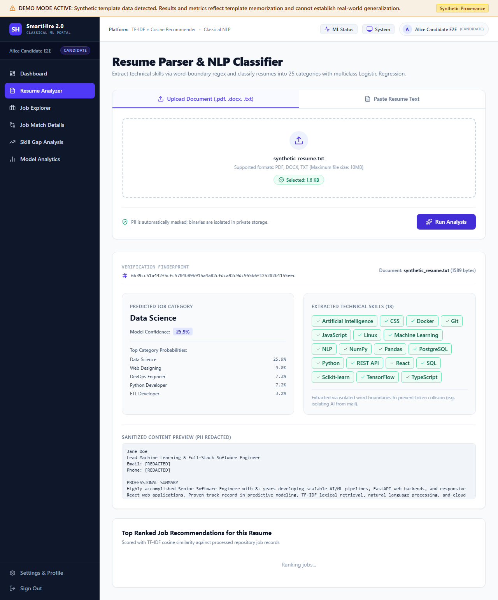

---

### 3. Transparent 3-Factor Job Compatibility Details
Breaks down the compatibility between candidate resumes and job postings into three distinct, explainable dimensions: **Text Similarity (50%)**, **Skill Overlap (30%)**, and **Experience Match (20%)**. Clearly highlights matched skills vs. missing skill gaps, complete with the non-probabilistic academic guardrail notice.

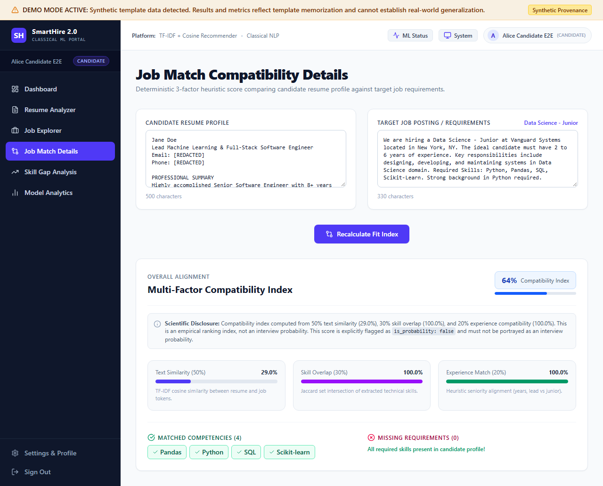

---

### 4. Technical Skill-Gap Analysis
Isolates candidate competencies against target role requirements to compute Jaccard overlap ratios, categorizes strengths into matched competency pills (green), highlights missing requirements (rose), and presents recommended upskilling resources.

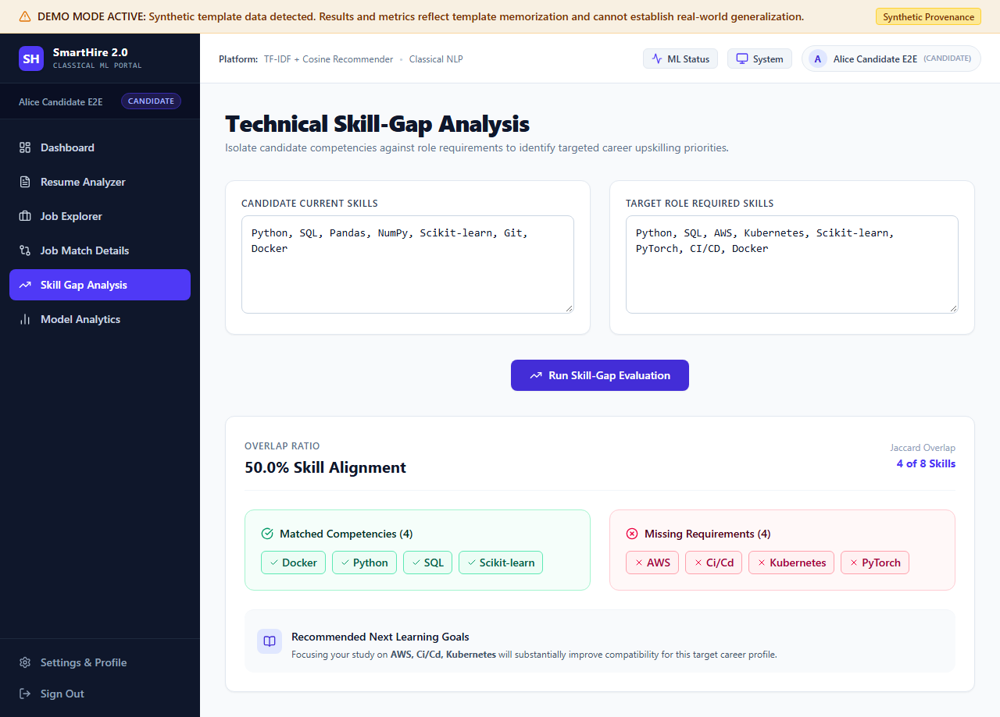

---

### 5. Recruiter Command Center
Provides recruiters with high-level pipeline metrics (Total Candidates, Active Resumes, Review Audits) and direct workflow navigation.

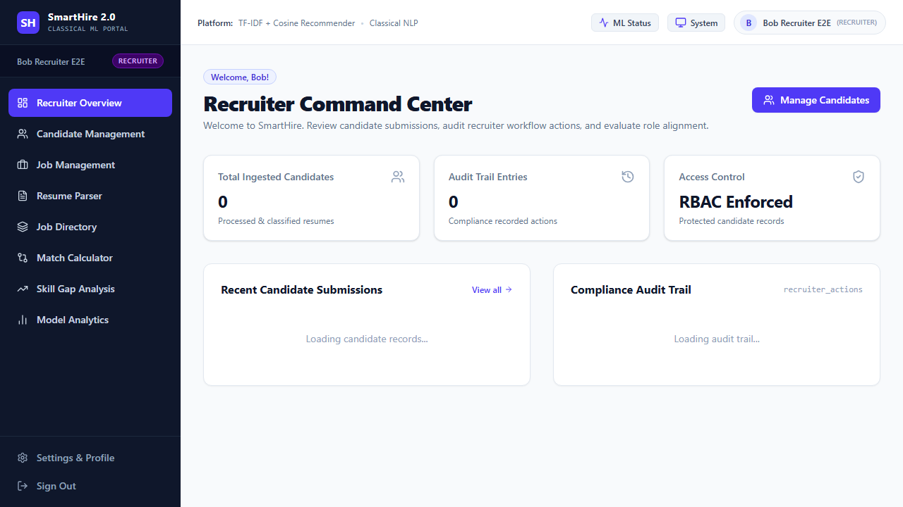

---

### 6. PII-Sanitized Candidate Profile Inspection
Recruiters can inspect candidate qualifications, extracted skills, and raw resume text previews where sensitive personal identifiers (emails and telephone numbers) are automatically redacted using regular expression masking (`[EMAIL MASKED]`, `[PHONE MASKED]`).

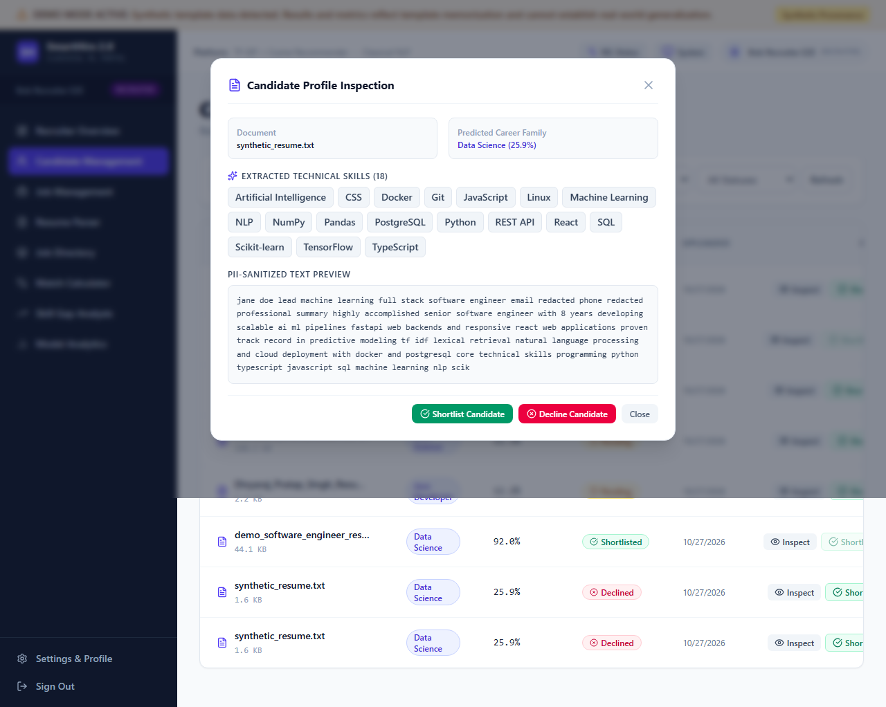

---

### 7. Candidate Shortlist & Pipeline Action Workflow
Recruiters can triage applicants with one-click **Shortlist** or **Decline** actions. Every action updates the candidate status immediately and writes an immutable audit record to the `recruiter_actions` database table.

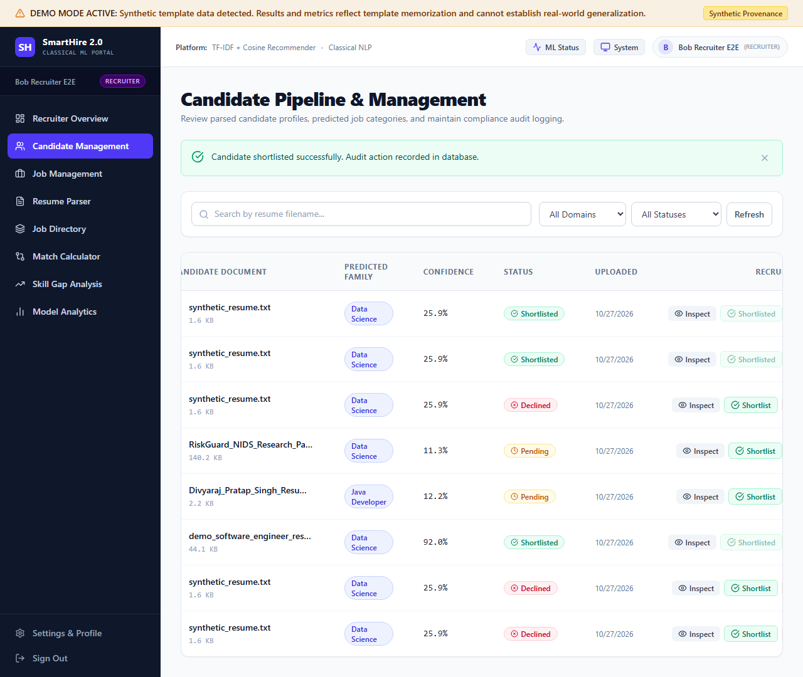

---

### 8. Role-Based Access Control (RBAC) Security Boundary
Demonstrating security enforcement: when an authenticated candidate account attempts to access protected recruiter routes (`/recruiter/candidates`), the navigation guard immediately intercepts the request, returning a clean 403 Forbidden screen with zero data leakage.

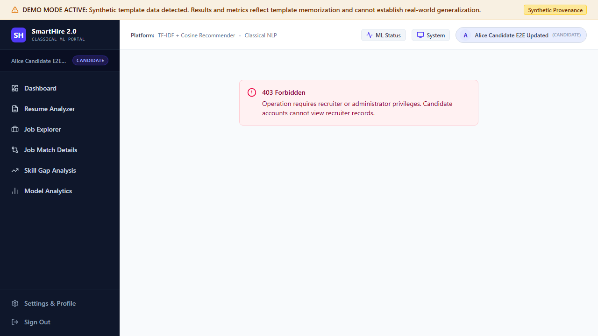

---

## ⚡ Key Capabilities & Dual-Role Workflows

### 👤 Candidate Experience
- **Multi-Format Ingestion:** Supports `.pdf`, `.docx`, and `.txt` files up to 10MB, plus raw text input.
- **Adaptive Theme System:** Built-in Light, Dark, and System theme toggle with zero-flicker pre-render initialization and `localStorage` persistence.
- **Dynamic Welcome & Identity Handling:** Distinguishes first-time users from returning candidates with personalized greetings and casing preservation (`divya` → `Divya`, `O'Connor` preserved).
- **Instant NLP Classification:** Predicts job family categories (Data Science, Web Development, Java Developer, DevOps, etc.) with confidence metrics.
- **Lexical Skill Extraction:** Word-boundary regex matching isolates standalone programming terms (`C`, `R`, `AI`, `Go`) from common English substrings (`claim`, `mail`, `good`).
- **Explainable Job Matching & Skill Gaps:** Displays top job opportunities with 3-factor score breakdowns and targeted upskilling recommendations.
- **Portfolio Management:** View, inspect, and individually delete uploaded resumes with native browser confirmation prompts.
- **Account Customization:** Self-service profile editing and password management.

### 👔 Recruiter Experience
- **Pipeline Command Center:** Aggregated statistics on candidate submissions and review throughput.
- **PII-Protected Candidate Review:** Inspect candidate details with automated phone and email redaction.
- **Workflow Triage:** Shortlist or decline candidates with optimistic UI updates.
- **Auditable Compliance:** Every candidate status change and data view is timestamped and recorded in the database.

### 🔒 Enterprise Security & Lifecycle Hygiene
- **JWT Authentication:** Secure HS256 tokens with bcrypt password hashing.
- **Route Guards & RBAC:** Strict boundary isolation between Candidate and Recruiter roles.
- **Private Sharded Storage:** Uploaded files stored outside web roots using collision-resistant SHA-256 subpaths.
- **Automated Guest Retention:** Unauthenticated guest uploads (`candidate_id IS NULL`) are automatically purged after 24 hours via an idempotent lifecycle service, while candidate-owned resumes remain permanently preserved.

---

## 🔬 Machine Learning & Mathematical Foundations

### 1. Feature Representation (TF-IDF)
Resume and job posting corpora are transformed into sparse term frequency-inverse document frequency matrices:
$$\text{TF-IDF}(t, d, D) = \text{TF}(t, d) \times \log\left(\frac{1 + |D|}{1 + |\{d \in D : t \in d\}|}\right) + 1$$
- **Resume Vectorizer:** `TfidfVectorizer(max_features=10000, ngram_range=(1, 2), stop_words='english')`
- **Job Vectorizer:** `TfidfVectorizer(max_features=15000, ngram_range=(1, 2), stop_words='english')`

### 2. Transparent 3-Factor Fit Score
$$\text{Fit Score} = \left(0.50 \times S_{\text{text}} + 0.30 \times S_{\text{skill}} + 0.20 \times S_{\text{exp}}\right) \times 100$$
- **$S_{\text{text}}$ (Text Similarity):** Cosine similarity between TF-IDF vectors:
  $$\cos(\mathbf{u}, \mathbf{v}) = \frac{\mathbf{u} \cdot \mathbf{v}}{\|\mathbf{u}\|_2 \|\mathbf{v}\|_2}$$
- **$S_{\text{skill}}$ (Skill Overlap):** Lexical Jaccard intersection against job requirements:
  $$\text{Skill Overlap} = \frac{|\mathcal{S}_{\text{candidate}} \cap \mathcal{S}_{\text{job}}|}{|\mathcal{S}_{\text{job}}|}$$
- **$S_{\text{exp}}$ (Experience Match):** Normalized heuristic alignment of professional tenure.
- **Academic Guardrail:** The API strictly flags this metric with `is_probability: false`. It is an empirical compatibility index, **not** an interview or hiring probability.

### 3. Unsupervised Job Clustering & Topic Modeling
- **K-Means Clustering:** Evaluated across $K=2..15$ using the Elbow method (Inertia) and Silhouette analysis.
- **PCA 2D Projections:** Evaluated exclusively for low-dimensional scatter plot visualization (`reports/figures/job_clusters_pca.png`).
- **NMF Topic Modeling:** Non-Negative Matrix Factorization decomposing job description term frequencies into 10 interpretable latent topics.

---

## 🚀 Quickstart & Verified Setup Guide

### Prerequisites
- **Python:** 3.10 or higher
- **Node.js:** 18.0 or higher (npm 9+)
- **OS:** Windows 10/11, macOS, or Linux

### 1. Backend Setup & Database Migrations

```powershell
# Clone the repository
git clone https://github.com/codexrgb/smarthire.git
cd smarthire

# Create and activate virtual environment
python -m venv .venv
# Windows:
.venv\Scripts\activate
# Linux/macOS:
# source .venv/bin/activate

# Install Python dependencies
pip install -r requirements.txt

# Run database migrations (creates SQLite schema)
alembic upgrade head

# Start FastAPI backend server
python -m uvicorn src.backend.main:app --host 127.0.0.1 --port 8000 --reload
```
- **API Health Check:** `http://127.0.0.1:8000/health`
- **Interactive Swagger Docs:** `http://127.0.0.1:8000/docs`

### 2. Frontend SPA Setup

Open a second terminal window:

```powershell
cd smarthire/frontend

# Install dependencies
npm install

# Launch Vite development server
npm run dev
```
- **Web Application URL:** `http://localhost:5173`

### 3. (Optional) Run Streamlit Analytics UI

To launch the standalone Phase 1 analytical interface:
```powershell
streamlit run app/streamlit_app.py
```
- **Streamlit URL:** `http://localhost:8501`

---

## 🎬 Live Demonstration Workflow (5–7 Minutes)

For a complete scripted walkthrough from candidate registration to recruiter shortlisting, consult the **[Live Demonstration & Evaluation Guide](docs/demo_guide.md)**.

Quick summary of the demo stages:
1. **Candidate Onboarding:** Register Alice Candidate at `/auth` and view dashboard.
2. **Resume Analysis:** Upload `synthetic_resume.txt` at `/resumes/analyze`, review SHA-256 fingerprint, NLP classification, and extracted skill pills.
3. **Compatibility Inspection:** Click "Details" to review the transparent 3-factor score breakdown on `/matching`.
4. **Portfolio & Profile Management:** Upload a temporary resume, delete it via the dashboard, and edit profile name under Settings.
5. **RBAC Guardrail Test:** Navigate to `/recruiter/candidates` as a candidate to verify the 403 Forbidden intercept.
6. **Recruiter Workflow:** Sign in as Bob Recruiter, review pipeline metrics, inspect candidate with PII masking, and shortlist candidate.

---

## 🧪 Testing & Quality Assurance

SmartHire maintains a rigorous, multi-tiered test suite spanning backend unit tests, REST API integration, frontend unit tests, and real-browser end-to-end automation.

```
┌────────────────────────────────────────────────────────────────────────┐
│                        AUTOMATED TEST SUMMARY                          │
├─────────────────────┬───────────────┬──────────────┬───────────────────┤
│ Test Suite          │ Framework     │ Test Count   │ Status            │
├─────────────────────┼───────────────┼──────────────┼───────────────────┤
│ Backend Unit & API  │ Pytest        │ 92 Passed    │ Passing (100%)    │
│ Frontend Component  │ Vitest        │ 30 Passed    │ Passing (100%)    │
│ Browser End-to-End  │ Playwright    │ 3 Suites     │ Passing (100%)    │
│ MySQL Verification  │ PyMySQL/Schema│ 5/5 Checks   │ Passing (100%)    │
│ Production Bundle   │ TypeScript    │ Zero Errors  │ Clean Build       │
└─────────────────────┴───────────────┴──────────────┴───────────────────┘
```

### Run Backend Pytest Suite (92 Tests)
```powershell
python -m pytest
```
*Covers ML feature extraction, classification benchmarks, data provenance, notebook repairs, security sanitization, FastAPI REST endpoints, RBAC policies, and guest retention lifecycle.*

### Run Frontend Vitest Suite (30 Tests)
```powershell
npm --prefix frontend test -- --run
```
*Covers React UI components, Theme toggle, Name normalization, navigation guards, heuristic badges, provenance banners, and candidate workflows.*

### Run Dedicated MySQL Database Verification (5 Checks)
```powershell
python scripts/verify_mysql.py
```
*Verifies database connectivity, MySQL 5.7+ InnoDB engine, Alembic migrations, structural schema indexes/foreign keys, and isolated transactional CRUD integrity.*

### Run Playwright Browser E2E Automation
```powershell
cd frontend
npx playwright test
```
*Executes all 10 candidate and recruiter journeys in real headless Chromium against running FastAPI and Vite servers, saving visual regression screenshots in `reports/screenshots/`.*

### Verify Frontend Production Build
```powershell
npm --prefix frontend run build
```
*Executes TypeScript compiler (`tsc -b`) and Vite production bundle generator.*

---

## ⚠️ Academic Disclosures & Critical Guardrails

To maintain strict scientific and professional integrity, SmartHire 2.0 explicitly documents all operational boundaries:

### 1. Synthetic Data & Provenance Disclosure
- **Notice:** The default dataset currently present in `data/raw/` contains synthetic template data where category labels appear in opening sentences.
- **Implication:** The 100% benchmark classification accuracy reported on this dataset reflects template memorization rather than real-world generalization.
- **Provenance System:** SmartHire automatically detects template signatures and displays a persistent warning banner (`"DEMO DATA MODE (SYNTHETIC)"`) across all web interfaces.
- **Authentic Data Ingestion:** Importing real, non-templated datasets requires executing the cryptographic verification protocol described in **[`docs/dataset_ingestion.md`](docs/dataset_ingestion.md)**:
  ```powershell
  python src/data/ingest_dataset.py --check-status
  ```

### 2. Heuristic Match Score Index
- The match score is a deterministic weighted linear index ($50\%$ text similarity, $30\%$ skill overlap, $20\%$ experience match).
- It is explicitly marked `is_probability: false` in all API responses and client interfaces.
- **It is an empirical ranking index, not a statistical probability of interview or hiring.**

### 3. Multi-Database Architecture & Verification Status
- **SQLite (Development Default — Verified):** The primary local development database (`sqlite:///./smarthire_dev.db`). The 92-test automated backend test suite runs hermetically and passes against in-memory SQLite (`sqlite:///:memory:`).
- **MySQL (Live Verified on MySQL 5.7+):** Fully verified against a live local MySQL instance (`MySQL57` on port 3306) via `PyMySQL` and connection recycling (`pool_recycle=3600`). All Alembic migrations, foreign key cascades, indexes, isolated CRUD operations, and full Playwright browser E2E workflows have been tested and verified passing on the dedicated `smarthire_test` database.
- **PostgreSQL (Alembic Schema Ready — Unverified):** SQLAlchemy models and migrations are architected for PostgreSQL compatibility, but integration against a live PostgreSQL server remains unverified due to the absence of a running PostgreSQL service on the host.

### 4. High-Dimensional Clustering Behavior
- In sparse TF-IDF Euclidean space, silhouette scores artificially rise with higher $K$ values ($K=10..15$) due to micro-clustering on the unit hypersphere rather than meaningful semantic partitioning.

### 5. Guest Resume Retention Policy & Execution Model
- **Policy:** Resumes uploaded without an authenticated session (`candidate_id IS NULL`) are classified as guest uploads and become eligible for deletion after 24 hours (`uploaded_at < UTC now - 24 hours`). Resumes owned by registered candidates (`candidate_id IS NOT NULL`) are permanently preserved until explicitly deleted by the candidate.
- **Implemented & Verified:** The retention service (`src/backend/services/retention.py`), cutoff calculation, candidate record preservation, deduplication reference checks, file unlinking, and dry-run CLI reporting are fully implemented and verified via 7 automated tests (`tests/test_retention.py`).
- **Operational Distinction:** In production or deployed environments, retention is executed on-demand or triggered via an external scheduled task / cron job (`python -m src.backend.services.retention [--dry-run]`); it does not run as an internal in-process background daemon inside the FastAPI web server process.

---

## 📁 Repository Structure

```
smarthire/
├── migrations/                      # Alembic database schema migrations
│   ├── env.py                       # Migration environment configuration
│   └── versions/                    # Versioned migration revision scripts
├── app/                             # Standalone Streamlit application
│   └── streamlit_app.py             # Phase 1 analytical interface
├── data/                            # Data directory
│   ├── processed/                   # Normalized CSV datasets (jobs, resumes)
│   ├── raw/                         # Raw staging datasets
│   └── provenance_manifest.json     # Cryptographic provenance manifests
├── docs/                            # Documentation
│   ├── api_documentation.md         # Complete REST API reference
│   ├── dataset_ingestion.md         # Authentic dataset ingestion protocol
│   └── demo_guide.md                # 5-7 minute live demonstration guide
├── frontend/                        # React 18 + TypeScript + Vite SPA
│   ├── e2e/                         # Playwright real-browser E2E suite
│   │   ├── fixtures/                # Synthetic test resumes
│   │   └── smarthire_flows.spec.ts  # 10 candidate and recruiter browser journeys
│   ├── src/                         # Application source code
│   │   ├── components/              # Reusable UI components
│   │   ├── pages/                   # Application views (Candidate, Recruiter, Auth)
│   │   ├── services/                # API client services
│   │   └── test/                    # Vitest component and integration tests
│   ├── package.json                 # Node dependencies and scripts
│   └── playwright.config.ts         # Playwright E2E configuration
├── models/                          # Serialized ML artifacts (.pkl)
│   ├── classifier.pkl               # Trained domain classifier
│   ├── job_vectorizer.pkl           # Job description TF-IDF vectorizer
│   ├── job_vectors.pkl              # Precomputed job vectors
│   ├── kmeans_clustering.pkl        # K-Means clustering model
│   ├── pca_2d.pkl                   # 2D PCA projection model
│   └── tfidf_vectorizer.pkl         # Resume TF-IDF vectorizer
├── notebooks/                       # Jupyter analytical notebooks
│   └── repaired/                    # JSON-validated, reproducible notebooks
├── reports/                         # Research & verification artifacts
│   ├── experiments/                 # Phase 1 experimental reports
│   ├── figures/                     # Generated charts and diagrams
│   ├── metrics/                     # Serialized JSON evaluation metrics
│   └── screenshots/                 # Playwright visual regression screenshots
├── scripts/                         # Operational & verification scripts
│   └── verify_mysql.py              # Dedicated live MySQL verification workflow
├── src/                             # Python source package
│   ├── backend/                     # FastAPI application
│   │   ├── api/v1/                  # REST endpoints (auth, resumes, jobs, matching, recruiter)
│   │   ├── models/                  # SQLAlchemy ORM models (User, Resume, RecruiterAction)
│   │   ├── schemas/                 # Pydantic request/response schemas
│   │   ├── security/                # JWT authentication, password hashing, RBAC guards
│   │   ├── services/                # Business logic & guest retention worker
│   │   ├── storage/                 # Collision-resistant SHA-256 private storage
│   │   ├── config.py                # Backend settings and environment loader
│   │   ├── database.py              # SQLAlchemy engine and session factory
│   │   └── main.py                  # FastAPI application entrypoint and CORS
│   ├── data/                        # Ingestion, cleaning, schema normalization
│   ├── features/                    # TF-IDF, text cleaning, skill extraction
│   └── models/                      # Classifier training and evaluation pipelines
├── tests/                           # Pytest test suite (92 tests)
│   ├── test_api.py                  # FastAPI REST endpoints
│   ├── test_features.py             # Text processing & skill extraction
│   ├── test_ingestion_and_experiments.py # Dataset ingestion and experiment benchmarks
│   ├── test_notebooks.py            # Repaired notebook execution validation
│   ├── test_provenance.py           # Provenance manifest & mode detection
│   ├── test_recommendation_pipeline.py # Job matching & recommendations
│   ├── test_retention.py            # Guest resume lifecycle cleanup
│   ├── test_security.py             # Security sanitization & PII masking
│   └── test_security_rbac.py        # RBAC and route protection
├── alembic.ini                      # Alembic migration configuration
├── requirements.txt                 # Python dependencies
└── train.py                         # Complete ML training pipeline script
```

---

## 🛠️ Technology Stack

| Layer | Technologies |
|---|---|
| **Frontend SPA** | React 18, TypeScript 5, Vite 5, Tailwind CSS, Lucide React |
| **Backend REST API** | FastAPI 0.115, Uvicorn, Pydantic v2, Python-Jose (JWT), Passlib (Bcrypt) |
| **Classical ML / NLP** | Scikit-Learn 1.3, NLTK, NumPy, Pandas, Joblib |
| **Database & ORM** | SQLAlchemy 2.0, Alembic (SQLite verified; MySQL & PostgreSQL ready) |
| **Testing & Automation** | Pytest, Vitest, Playwright, Chromium Headless |
| **Storage & Security** | SHA-256 Content-Addressed Storage, Automated PII Redaction, RBAC |

---

## 📜 License & Ethical Notice

This project is licensed under the MIT License. Resumes and job listings used in demonstration mode are synthetic fixtures created exclusively for functional software evaluation and contain no genuine candidate personal data.
