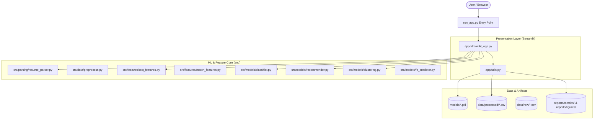
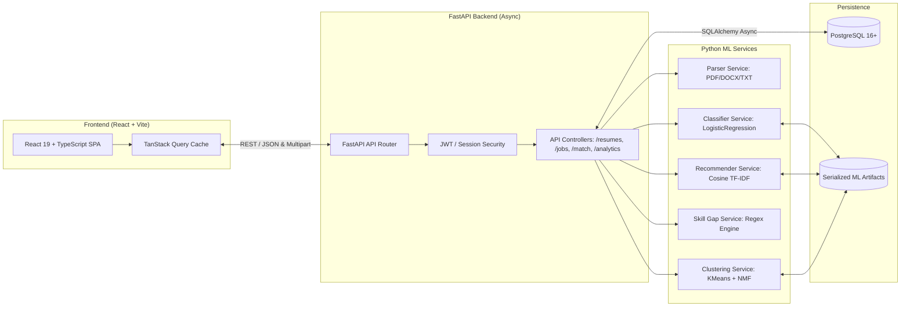
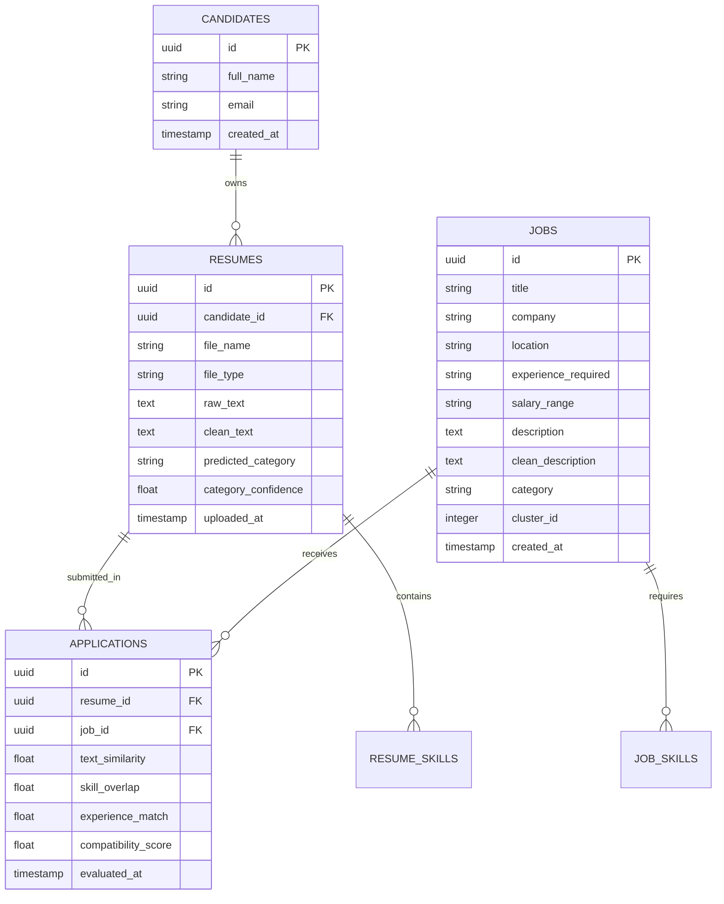
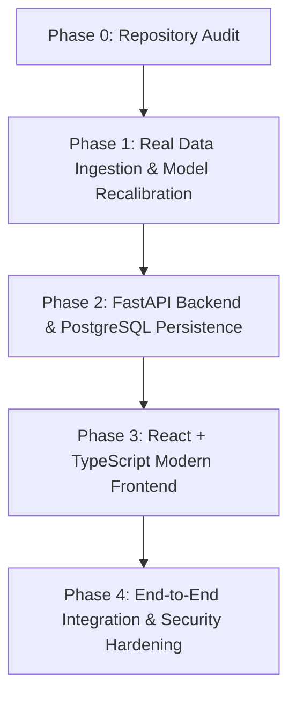

# SmartHire 2.0 — Phase 0: Comprehensive Repository Audit & Architectural Assessment

**Audit Timestamp:** October 26, 2026  
**Auditor:** SmartHire 2.0 Engineering Pair Programmer (Antigravity)  
**Target Repository:** `c:/Users/ps331/OneDrive/Desktop/smarthire`  
**Git Branch:** `main` (Clean working tree, aligned with `origin/main` at commit `fd37819`)  
**Operating Environment:** Windows (PowerShell), Python 3.10.11, scikit-learn 1.7.2, pandas 2.3.3, pytest 9.1.1  

---

## Executive Summary

SmartHire 1.0 is an academic machine learning portal built using Streamlit and classical scikit-learn NLP techniques (TF-IDF, Logistic Regression, LinearSVC, Cosine Similarity, K-Means, PCA, NMF). The project is entirely local and contains no cloud LLM API dependencies.

This Phase 0 audit was conducted under strict safety rules (read-only inspection, zero file modifications, zero retrainings, zero dependency installations). All 11 unit tests in `tests/test_features.py` were safely executed and **PASSED (11/11 in 14.38s)**.

The audit uncovered critical discrepancies between documentation/reports and underlying data integrity:
1. **Classifier 100% Accuracy Root Cause**: The raw datasets in `data/raw/` are not authentic Kaggle datasets; they are synthetic datasets created by `src/data/generate_sample_data.py`. 100% of resume records explicitly start with `"Experienced <Category> professional with X years..."`, causing severe label leakage and trivial 100% test accuracy that cannot generalize to real resumes.
2. **False Real-Data Mode Flag**: The system flagged itself as `"is_demo_mode": false` because synthetic files were saved using the exact file names of the expected Kaggle datasets (`UpdatedResumeDataSet.csv`, `naukri_com-job_sample.csv`, `linkedin_job_postings.csv`), bypassing detection.
3. **Fit Score Classification**: The "ML-Based Fit Score" is a deterministic linear heuristic formula ($0.50 \times \text{TextSim} + 0.30 \times \text{SkillMatch} + 0.20 \times \text{ExpMatch}$), NOT a trained, calibrated statistical probability.
4. **Clustering & Silhouette Paradox**: Selected $K=5$ is hardcoded via configuration (`DEFAULT_N_CLUSTERS = 5`), whereas the silhouette score peaks at $K=10$ ($0.1108$). Both scores reflect low spherical separation in TF-IDF Euclidean space.
5. **Corrupted Notebook Files**: Four of the five Jupyter notebooks (`02`, `03`, `04`, `05`) contain invalid literal newlines inside JSON strings, preventing them from opening in standard Jupyter environments.
6. **Suspicious Root File**: The file `ntent README.md)  ForEach-Object { $_.TrimEnd() }  Set-Content README.md` was created by a botched PowerShell whitespace-trimming pipeline containing unicode pipe characters (`\uF07C`) and git diff warnings. It has been preserved intact per safety guidelines.

---

## Section A: Repository Architecture & Entry Points



### Application Entry Points
- **Primary Web App Launcher:** [`run_app.py`](file:///c:/Users/ps331/OneDrive/Desktop/smarthire/run_app.py)  
  *Invokes `sys.executable -m streamlit run app/streamlit_app.py` after validating file presence.*
- **Direct Web App Script:** [`app/streamlit_app.py`](file:///c:/Users/ps331/OneDrive/Desktop/smarthire/app/streamlit_app.py)  
  *Contains 8 multi-page views with custom CSS injected via `app/utils.py`.*
- **Training Pipeline Runner:** [`train.py`](file:///c:/Users/ps331/OneDrive/Desktop/smarthire/train.py)  
  *13-step batch orchestration script executing data ingestion, cleaning, model training, plot generation, and metric reporting.*
- **Test Suite Entry:** `pytest tests/`  
  *Executes unit test suite in [`tests/test_features.py`](file:///c:/Users/ps331/OneDrive/Desktop/smarthire/tests/test_features.py).*

---

## Section B: Directory-by-Directory Implementation Audit

### 1. `app/` Directory
- [`app/streamlit_app.py`](file:///c:/Users/ps331/OneDrive/Desktop/smarthire/app/streamlit_app.py) (715 lines):
  - Streamlit multi-tab dashboard covering:
    1. Dashboard: Dataset statistics and quick preset demo profiles.
    2. Resume Analysis: File uploader (PDF/DOCX/TXT) or manual input, category prediction, confidence bar chart, skill extraction pill badges.
    3. Job Recommendations: Cosine similarity ranking, category filter, top-N selector, fit score progress bars.
    4. Skill Gap: Detailed breakdown of matched skills, missing skills, and recommendations.
    5. Job Explorer: Searchable, filterable interactive table with CSV export.
    6. Job Clustering: Elbow curve, silhouette curve, 2D PCA cluster scatter plot, NMF topic keyword display.
    7. Model Analytics: Accuracy, weighted precision/recall/F1 metrics, confusion matrix heatmap.
    8. About: Architecture overview and academic integrity notice.
- [`app/utils.py`](file:///c:/Users/ps331/OneDrive/Desktop/smarthire/app/utils.py) (213 lines):
  - Model caching via `@st.cache_resource` for `classifier.pkl`, `tfidf_vectorizer.pkl`, `job_vectorizer.pkl`, `job_vectors.pkl`, and `kmeans_clustering.pkl`.
  - Processed CSV caching via `@st.cache_data`.
  - UI custom CSS styling injection (`.metric-card`, `.job-card`, `.skill-pill`, etc.).
  - Preset sample resumes for 4 roles (Data Scientist, Java Developer, DevOps Engineer, Business Analyst).

### 2. `src/` Directory
- [`src/config.py`](file:///c:/Users/ps331/OneDrive/Desktop/smarthire/src/config.py) (153 lines):
  - Centralizes project root, directory paths, and hyperparameters.
  - `COLUMN_ALIASES`: Dynamic column header mapping dictionary for Kaggle datasets.
  - `SKILL_ALIAS_MAP`: 85 normalized alias mappings to canonical tech skills.
  - `MASTER_SKILLS`: Alphabetical deduplicated list of canonical tech skills.
  - Hyperparameters: `CLASSIFIER_TFIDF_PARAMS` (`max_features=10000`, `ngram_range=(1,2)`, `min_df=2`, `sublinear_tf=True`), `RECOMMENDER_TFIDF_PARAMS` (`max_features=15000`, `ngram_range=(1,2)`), `DEFAULT_N_CLUSTERS=5`.
- [`src/data/preprocess.py`](file:///c:/Users/ps331/OneDrive/Desktop/smarthire/src/data/preprocess.py) (82 lines):
  - Text normalization function [`clean_text()`](file:///c:/Users/ps331/OneDrive/Desktop/smarthire/src/data/preprocess.py#L37-L81).
  - Punctuation stripping with special protection for technical terms: `C++` $\to$ `cplusplus`, `C#` $\to$ `csharp`, `.NET` $\to$ `dotnet`, `Node.js` $\to$ `nodejs`, `React.js` $\to$ `reactjs`, `Vue.js` $\to$ `vuejs`, `Express.js` $\to$ `expressjs`, `PL/SQL` $\to$ `plsql`, `REST API` $\to$ `restapi`.
- [`src/data/load_data.py`](file:///c:/Users/ps331/OneDrive/Desktop/smarthire/src/data/load_data.py) (234 lines):
  - Ingestion, schema normalization, and deduplication.
  - [`check_real_datasets_exist()`](file:///c:/Users/ps331/OneDrive/Desktop/smarthire/src/data/load_data.py#L19-L43): Validates presence of `UpdatedResumeDataSet.csv`, `naukri_com-job_sample.csv`, and `linkedin_job_postings.csv`.
  - [`clean_and_normalize_data()`](file:///c:/Users/ps331/OneDrive/Desktop/smarthire/src/data/load_data.py#L169-L223): Deduplicates resumes on `resume_text` and jobs on `[title, company, description]`.
- [`src/data/generate_sample_data.py`](file:///c:/Users/ps331/OneDrive/Desktop/smarthire/src/data/generate_sample_data.py) (153 lines):
  - Generates synthetic resumes (960 rows) and synthetic job listings (350 rows) across 25 job categories when raw files are absent.
- [`src/features/text_features.py`](file:///c:/Users/ps331/OneDrive/Desktop/smarthire/src/features/text_features.py) (158 lines):
  - [`extract_skills()`](file:///c:/Users/ps331/OneDrive/Desktop/smarthire/src/features/text_features.py#L35-L90): Length-descending span-tracking regex extractor ensuring multi-word terms (e.g. `Spring Boot`) take precedence over sub-words (e.g. `Spring`).
  - Strict standalone regex `\b(?:AI|A\.I\.)\b` to prevent false positive extraction from words like `mail`, `claim`, or `tail`.
  - [`calculate_skill_match()`](file:///c:/Users/ps331/OneDrive/Desktop/smarthire/src/features/text_features.py#L99-L135): Set intersection and difference calculation with division-by-zero protection.
- [`src/features/match_features.py`](file:///c:/Users/ps331/OneDrive/Desktop/smarthire/src/features/match_features.py) (89 lines):
  - [`extract_experience_years()`](file:///c:/Users/ps331/OneDrive/Desktop/smarthire/src/features/match_features.py#L12-L36): Regex-based experience parser handling ranges (`3-5 years` $\to 4.0$).
  - [`calculate_experience_compatibility()`](file:///c:/Users/ps331/OneDrive/Desktop/smarthire/src/features/match_features.py#L39-L50): Ratio computation capped at 1.0.
  - [`compute_pair_match_features()`](file:///c:/Users/ps331/OneDrive/Desktop/smarthire/src/features/match_features.py#L53-L88): Computes linear combination score.
- [`src/models/classifier.py`](file:///c:/Users/ps331/OneDrive/Desktop/smarthire/src/models/classifier.py) (200 lines):
  - Trains and benchmarks `LogisticRegression(max_iter=1000, C=1.0)` vs. `LinearSVC(C=1.0, dual="auto")` on 80/20 stratified split.
  - Saves best model to `models/classifier.pkl` and metrics to `reports/metrics/classifier_metrics.json`.
- [`src/models/recommender.py`](file:///c:/Users/ps331/OneDrive/Desktop/smarthire/src/models/recommender.py) (112 lines):
  - Fits TF-IDF vectorizer on job corpus and computes pairwise cosine similarity against resume TF-IDF vector.
- [`src/models/clustering.py`](file:///c:/Users/ps331/OneDrive/Desktop/smarthire/src/models/clustering.py) (529 lines):
  - K-Means evaluation across $K=2..10$ for inertia and silhouette scores.
  - PCA 2D scatter visualization.
  - NMF topic modeling extracting top 10 keywords per topic.
- [`src/models/fit_predictor.py`](file:///c:/Users/ps331/OneDrive/Desktop/smarthire/src/models/fit_predictor.py) (91 lines):
  - Fallback handler: returns heuristic ML Fit Score when labeled pair dataset is absent.
- [`src/evaluate.py`](file:///c:/Users/ps331/OneDrive/Desktop/smarthire/src/evaluate.py) (146 lines):
  - Standalone evaluation script re-computing classification report, confusion matrix, and clustering metrics.

### 3. `models/` Directory (Verified Binary Artifacts)
All 6 serialized `.pkl` models were loaded in Python 3.10.11 and verified:
- [`models/classifier.pkl`](file:///c:/Users/ps331/OneDrive/Desktop/smarthire/models/classifier.pkl) (385.7 KB): Serialized `LogisticRegression` model.
- [`models/tfidf_vectorizer.pkl`](file:///c:/Users/ps331/OneDrive/Desktop/smarthire/models/tfidf_vectorizer.pkl) (83.1 KB): Serialized `TfidfVectorizer` (vocabulary size 404 features on current data).
- [`models/job_vectorizer.pkl`](file:///c:/Users/ps331/OneDrive/Desktop/smarthire/models/job_vectorizer.pkl) (73.9 KB): Serialized `TfidfVectorizer` for job postings.
- [`models/job_vectors.pkl`](file:///c:/Users/ps331/OneDrive/Desktop/smarthire/models/job_vectors.pkl) (157.4 KB): Sparse `csr_matrix` of shape `(200, 396)`.
- [`models/kmeans_clustering.pkl`](file:///c:/Users/ps331/OneDrive/Desktop/smarthire/models/kmeans_clustering.pkl) (68.8 KB): Fitted `KMeans` model with $n\_clusters=5$.
- [`models/pca_2d.pkl`](file:///c:/Users/ps331/OneDrive/Desktop/smarthire/models/pca_2d.pkl) (41.0 KB): Fitted `PCA(n_components=2)` object.
- *Note:* `models/fit_predictor.pkl` does **not** exist (intended behavior, falls back to heuristic).

### 4. `data/` Directory
- `data/raw/UpdatedResumeDataSet.csv`: 960 rows, 3 columns (`Resume_id`, `Category`, `Resume_str`). **Synthetic data.**
- `data/raw/naukri_com-job_sample.csv`: 200 rows, 9 columns. **Synthetic data.**
- `data/raw/linkedin_job_postings.csv`: 150 rows, 9 columns. **Synthetic data.** (Identical to first 150 rows of Naukri file due to fixed RNG seed).
- `data/processed/resumes.csv`: 960 rows, 5 columns (`resume_id`, `resume_text`, `category`, `clean_text`, `source`).
- `data/processed/jobs.csv`: 200 rows, 11 columns (`job_id`, `title`, `company`, `location`, `skills`, `experience`, `salary`, `description`, `clean_description`, `category`, `source`).

### 5. `reports/` Directory
- `reports/metrics/classifier_metrics.json`: Records 100.0% accuracy, 1.0 macro/weighted precision/recall/F1, 25 classes, 192 test samples.
- `reports/metrics/clustering_metrics.json`: Records $K=5$ inertia (167.65), silhouette (0.0595), and best silhouette $K=10$ (0.1108).
- `reports/metrics/pipeline_status.json`: Records `is_demo_mode: false` (misleading due to synthetic file name collision).
- `reports/figures/`:
  - `confusion_matrix.png` (486.6 KB): 25x25 diagonal identity confusion matrix.
  - `elbow_curve.png` (138.5 KB): Inertia plot for $K=2..10$.
  - `silhouette_scores.png` (103.9 KB): Monotonically increasing curve up to $K=10$.
  - `job_clusters_pca.png` (180.0 KB): 2D PCA cluster scatter plot.
  - `pca_clusters.png` (180.7 KB): Legacy duplicate scatter plot.

### 6. `notebooks/` Directory
- [`notebooks/01_eda.ipynb`](file:///c:/Users/ps331/OneDrive/Desktop/smarthire/notebooks/01_eda.ipynb): Valid Jupyter notebook. Inspects resume category distribution.
- [`notebooks/02_resume_classifier.ipynb`](file:///c:/Users/ps331/OneDrive/Desktop/smarthire/notebooks/02_resume_classifier.ipynb): **Corrupted.** Contains raw unescaped newlines inside JSON code cell strings.
- [`notebooks/03_recommender.ipynb`](file:///c:/Users/ps331/OneDrive/Desktop/smarthire/notebooks/03_recommender.ipynb): **Corrupted.** Raw unescaped newlines in JSON.
- [`notebooks/04_clustering_topics.ipynb`](file:///c:/Users/ps331/OneDrive/Desktop/smarthire/notebooks/04_clustering_topics.ipynb): **Corrupted.** Raw unescaped newlines in JSON; also imports non-existent function `perform_nmf_topic_modeling` and passes DataFrame to `cluster_jobs()`.
- [`notebooks/05_fit_predictor.ipynb`](file:///c:/Users/ps331/OneDrive/Desktop/smarthire/notebooks/05_fit_predictor.ipynb): **Corrupted.** Raw unescaped newlines in JSON.

### 7. `tests/` Directory
- [`tests/test_features.py`](file:///c:/Users/ps331/OneDrive/Desktop/smarthire/tests/test_features.py) (169 lines):
  - 11 unit tests covering text cleaning, token protection, skill normalization, AI boundary checks, skill match percentages, pair match feature math, recommender ranking, clustering evaluation, and parser buffers.
  - All 11 tests execute in memory without touching disk files.

---

## Section C: Feature Verification Matrix

| Feature | Documented Status | Actual Implementation File | Verification Status | Operational Notes / Limitations |
| :--- | :--- | :--- | :--- | :--- |
| **PDF Resume Parsing** | Supported | [`src/parsing/resume_parser.py`](file:///c:/Users/ps331/OneDrive/Desktop/smarthire/src/parsing/resume_parser.py#L14) | **Verified Working** | Uses `pypdf`. Fails on scanned/image-only PDFs (no OCR). |
| **DOCX Resume Parsing** | Supported | [`src/parsing/resume_parser.py`](file:///c:/Users/ps331/OneDrive/Desktop/smarthire/src/parsing/resume_parser.py#L38) | **Verified Working** | Uses `python-docx`. Extracts paragraph text; misses tables and headers. |
| **TXT Resume Parsing** | Supported | [`src/parsing/resume_parser.py`](file:///c:/Users/ps331/OneDrive/Desktop/smarthire/src/parsing/resume_parser.py#L57) | **Verified Working** | Handles UTF-8 with Latin-1 fallback. |
| **Technical Token Preservation** | Supported | [`src/data/preprocess.py`](file:///c:/Users/ps331/OneDrive/Desktop/smarthire/src/data/preprocess.py#L10) | **Verified Working** | Successfully maps `C++`, `C#`, `.NET`, `Node.js`, `React.js` to alphanumeric tokens. |
| **Skill Extraction & Alias Normalization** | Supported | [`src/features/text_features.py`](file:///c:/Users/ps331/OneDrive/Desktop/smarthire/src/features/text_features.py#L35) | **Verified Working** | Strict regex boundary matching against 85 aliases; span precedence prevents sub-phrase masking. |
| **Skill-Gap Analysis** | Supported | [`src/features/text_features.py`](file:///c:/Users/ps331/OneDrive/Desktop/smarthire/src/features/text_features.py#L137) | **Verified Working** | Correctly outputs matched, missing, and match percentage. |
| **Resume Category Classifier** | Supported | [`src/models/classifier.py`](file:///c:/Users/ps331/OneDrive/Desktop/smarthire/src/models/classifier.py#L24) | **Verified Operational (Data Flawed)** | LogisticRegression / LinearSVC runs; achieves 100% test accuracy due to synthetic label leakage. |
| **TF-IDF Job Recommendation** | Supported | [`src/models/recommender.py`](file:///c:/Users/ps331/OneDrive/Desktop/smarthire/src/models/recommender.py#L42) | **Verified Working** | Cosine similarity ranking working as expected. |
| **Fit Score Calculation** | Supported | [`src/features/match_features.py`](file:///c:/Users/ps331/OneDrive/Desktop/smarthire/src/features/match_features.py#L53) | **Verified Working (Heuristic)** | Deterministic $50/30/20$ weighted score; not a statistical probability. |
| **K-Means Job Clustering** | Supported | [`src/models/clustering.py`](file:///c:/Users/ps331/OneDrive/Desktop/smarthire/src/models/clustering.py#L346) | **Verified Working** | Runs KMeans; $K=5$ is configuration-selected, not algorithmic elbow. |
| **PCA 2D Visualization** | Supported | [`src/models/clustering.py`](file:///c:/Users/ps331/OneDrive/Desktop/smarthire/src/models/clustering.py#L391) | **Verified Working** | Reduces TF-IDF to 2D for scatter plot rendering. |
| **NMF Topic Modeling** | Supported | [`src/models/clustering.py`](file:///c:/Users/ps331/OneDrive/Desktop/smarthire/src/models/clustering.py#L482) | **Verified Working** | Extracts top 10 keywords across 5 latent topics. |
| **Supervised Fit Predictor** | Documented | [`src/models/fit_predictor.py`](file:///c:/Users/ps331/OneDrive/Desktop/smarthire/src/models/fit_predictor.py#L21) | **Fallback Stub Only** | No labeled candidate-job ground truth exists. Always falls back to heuristic score. |

---

## Section D: In-Depth Investigation of Classifier Metrics (100% Accuracy)

The evaluation report in [`reports/metrics/classifier_metrics.json`](file:///c:/Users/ps331/OneDrive/Desktop/smarthire/reports/metrics/classifier_metrics.json) records:
- **Total Samples:** 960 resumes
- **Categories:** 25 classes
- **Train Split:** 768 samples (80%)
- **Test Split:** 192 samples (20%)
- **Duplicate Overlap Count:** 0
- **Test Accuracy:** 100.0%
- **Macro & Weighted Precision / Recall / F1:** 1.0000

### Audit Findings on Integrity and Generalization
1. **Split Integrity in Code:**
   The training split in [`src/models/classifier.py`](file:///c:/Users/ps331/OneDrive/Desktop/smarthire/src/models/classifier.py#L49) utilizes `train_test_split(..., test_size=0.2, random_state=42, stratify=y)`. The TF-IDF vectorizer is fit exclusively on `X_train_raw` and transforms `X_test_raw`. There is no programming bug or test-set leakage in the splitting script itself.
2. **The Root Cause — Synthetic Dataset Ingestion:**
   Inspection of `data/raw/UpdatedResumeDataSet.csv` reveals that this file was created by [`src/data/generate_sample_data.py`](file:///c:/Users/ps331/OneDrive/Desktop/smarthire/src/data/generate_sample_data.py#L57-L84).
   Every resume string was synthesized using the exact template:
   ```python
   text = (
       f"Experienced {cat} professional with {years_exp} years of experience in industry projects. "
       f"Education: {degree}. Proven track record in delivery and execution. "
       f"Key technical skills and competencies include: {', '.join(selected_skills)}. "
       f"Demonstrated proficiency in {selected_skills[0]} and {selected_skills[-1]}. "
       f"Worked on cross-functional teams to deliver high-quality solutions."
   )
   ```
3. **Data Verification:**
   - **960 out of 960 (100.00%)** resumes begin verbatim with `"Experienced <Category> professional..."`.
   - The TF-IDF vectorizer parameter `ngram_range=(1, 2)` produces unigrams and bigrams including `experienced <category>` and `<category> professional`.
   - These n-grams are perfect 1-to-1 proxies for the target label.
   - Furthermore, the skills assigned to each resume are sampled exclusively from category-specific skill dictionaries (`CATEGORY_SKILLS_MAP`), meaning skills like `Solidity` or `Ethereum` appear only in `Blockchain`, and `AutoCAD` appears only in `Civil Engineer` or `Mechanical Engineer`.
4. **Generalization Risk:**
   - **Severe/Catastrophic Risk:** The model has not learned to classify organic resumes based on varied descriptions of experience or diverse skill sets. It has merely memorized the template wording and category-exclusive tokens. When tested on real resumes that do not follow this synthetic template, accuracy will degrade substantially.
5. **Masked Demo Mode Banner:**
   In [`src/data/load_data.py`](file:///c:/Users/ps331/OneDrive/Desktop/smarthire/src/data/load_data.py#L19-L43), `check_real_datasets_exist()` only verifies whether file names exist in `data/raw/`. Because the synthetic generator outputted files named `UpdatedResumeDataSet.csv`, `naukri_com-job_sample.csv`, and `linkedin_job_postings.csv`, the check returned `True`, setting `"is_demo_mode": false` in `pipeline_status.json` and displaying a green "REAL DATA MODE ACTIVE" banner in the Streamlit UI, creating a false impression of real-world training.

---

## Section E: Job Clustering Analysis ($K=5$ vs. $K=10$)

In [`reports/metrics/clustering_metrics.json`](file:///c:/Users/ps331/OneDrive/Desktop/smarthire/reports/metrics/clustering_metrics.json):
- **Selected K:** 5 (Inertia: 167.65, Silhouette: 0.0595)
- **Best Silhouette K:** 10 (Silhouette: 0.1108, Inertia: 146.20)
- **Evaluated K Range:** $K \in [2, 10]$

### Silhouette Scores Progression
| K | Inertia | Silhouette Score | Trend |
| :---: | :---: | :---: | :---: |
| 2 | 182.46 | 0.0245 | Baseline |
| 3 | 177.33 | 0.0357 | Increasing |
| 4 | 172.39 | 0.0452 | Increasing |
| 5 | 167.65 | 0.0595 | Increasing (Config Selected) |
| 6 | 163.29 | 0.0699 | Increasing |
| 7 | 158.64 | 0.0802 | Increasing |
| 8 | 154.77 | 0.0855 | Increasing |
| 9 | 149.33 | 0.1018 | Increasing |
| 10 | 146.20 | 0.1108 | Maximum in evaluated range |

### Engineering Assessment & Trade-offs
1. **Arbitrary Elbow Selection:**
   [`src/models/clustering.py`](file:///c:/Users/ps331/OneDrive/Desktop/smarthire/src/models/clustering.py#L306) sets `"selected_elbow_k": DEFAULT_N_CLUSTERS`, where `DEFAULT_N_CLUSTERS = 5` in [`src/config.py`](file:///c:/Users/ps331/OneDrive/Desktop/smarthire/src/config.py#L149). It does not compute a mathematical elbow or knee point (e.g. using the second derivative of the inertia curve or the `kneed` algorithm).
2. **High-Dimensional Text Distance Concentration:**
   In TF-IDF vector spaces, data points reside on the surface of a high-dimensional unit hypersphere. Euclidean distance suffers from distance concentration, causing clusters to overlap significantly. A silhouette score of 0.1108 (and 0.0595 at $K=5$) indicates weak cluster cohesion and substantial boundary overlap.
3. **Monotonic Silhouette Increase:**
   Silhouette scores increase monotonically from $K=2$ to $K=10$ because partitioning 200 high-dimensional points into progressively smaller clusters reduces intra-cluster variance around isolated points. If $K$ were evaluated up to $K=25$, the silhouette score would likely continue to rise artificially.
4. **Recommended Validation Procedure for SmartHire 2.0:**
   - **Cosine Distance Clustering:** Migrate from Euclidean K-Means to Spherical K-Means or K-Means with normalized TF-IDF cosine distance.
   - **Algorithmic Elbow Detection:** Implement automated elbow detection (KneeLocator) to select $K$ algorithmically rather than via hardcoded configuration.
   - **Extrinsic Validation:** Compare cluster assignments against actual job categories (`job_category`) using Adjusted Rand Index (ARI), Normalized Mutual Information (NMI), and Homogeneity/Completeness scores.
   - **Semantic Topic Interpretability:** Evaluate cluster centroids using c-TF-IDF keyword extraction to ensure job families are business-meaningful.

---

## Section F: Fit Score Formula Analysis

The candidate-to-job matching feature in [`src/features/match_features.py`](file:///c:/Users/ps331/OneDrive/Desktop/smarthire/src/features/match_features.py#L79-L81) uses the formula:
$$\text{Fit Score} = \left(0.50 \times \text{TextSimilarity} + 0.30 \times \text{SkillOverlap} + 0.20 \times \text{ExperienceMatch}\right) \times 100$$

Where:
- $\text{TextSimilarity} \in [0, 1]$: Cosine similarity between resume TF-IDF and job TF-IDF.
- $\text{SkillOverlap} \in [0, 1]$: $\frac{|\text{Candidate Skills} \cap \text{Job Skills}|}{|\text{Job Skills}|}$.
- $\text{ExperienceMatch} \in [0, 1]$: $\min\left(1.0, \frac{\text{Candidate Exp Years}}{\text{Job Required Exp Years}}\right)$.

### Determination
> [!IMPORTANT]
> **The Fit Score is an empirical heuristic index, NOT a trained, calibrated statistical probability.**

1. **Uncalibrated Weights:** The weights ($50\%, 30\%, 20\%$) are hand-crafted heuristic coefficients. They were not derived from regression or classification optimization on historical hiring outcomes.
2. **No Ground Truth:** As acknowledged in `README.md` and [`src/models/fit_predictor.py`](file:///c:/Users/ps331/OneDrive/Desktop/smarthire/src/models/fit_predictor.py#L30), public datasets contain no historical candidate-job hire/reject ground truth labels.
3. **Labeling Recommendation:**
   The UI label `"ML-Based Fit Score"` must be renamed to `"Candidate Match Index"` or `"Multi-Factor Compatibility Score"`. It must **never** be presented to candidates or recruiters as an "interview probability" or "probability of hire."

---

## Section G: Inspection of Suspicious Root File

### File Specifications
- **Exact Name:** `ntent README.md)  ForEach-Object { $_.TrimEnd() }  Set-Content README.md`
- **Full Path:** `c:\Users\ps331\OneDrive\Desktop\smarthire\ntent README.md)  ForEach-Object { $_.TrimEnd() }  Set-Content README.md`
- **File Size:** 3,566 bytes
- **Encoding & Glyphs:** Contains the Unicode Private Use Area glyph `\uF07C` (decimal 61564), which visually renders as a vertical bar / pipe in certain terminal fonts.

### File Contents Summary
The file contains plain text diagnostic output from `git diff --check` (or a git commit hook) reporting trailing whitespace errors across multiple project files:
- `README.md` lines 4, 40, 50, 52
- `app/streamlit_app.py` lines 252, 297
- `app/utils.py` line 96
- `src/data/generate_sample_data.py` lines 61, 66, 69, 77, 83, 91, 96, 101, 105, 112, 124, 136, 142
- `src/data/load_data.py` lines 22, 27, 40, 73, 196

### Incident Root Cause
A user or script attempted to trim trailing whitespace using a PowerShell command such as:
`(Get-Content README.md) | ForEach-Object { $_.TrimEnd() } | Set-Content README.md`
However, the command was pasted with an invalid Unicode pipe symbol (`\uF07C`) instead of ASCII `|` (0x7C), causing the shell to parse the pipeline string as a command argument or output redirection target, writing the git output to this file name.

### Preservation Notice
In accordance with Rule 5 and Rule 8 of the Phase 0 Safety Protocol, this file was **neither modified, renamed, nor deleted**.

---

## Section H: Operational Infrastructure, Parsing, Privacy & Tests

### 1. File Uploads & Document Parsing
- **Supported Formats:** PDF, DOCX, TXT.
- **PDF Engine:** [`pypdf.PdfReader`](file:///c:/Users/ps331/OneDrive/Desktop/smarthire/src/parsing/resume_parser.py#L26). Extracts text streams page-by-page. Does not perform Optical Character Recognition (OCR); scanned PDFs yield empty strings.
- **DOCX Engine:** [`docx.Document`](file:///c:/Users/ps331/OneDrive/Desktop/smarthire/src/parsing/resume_parser.py#L50). Extracts `doc.paragraphs`. Ignores tables, text boxes, and headers/footers.
- **TXT Engine:** Decodes UTF-8 with Latin-1 fallback.
- **Buffer Safety:** Correctly handles 0-byte uploaded buffers, returning an informative status message.

### 2. Error Handling & Security Deficits
- **Lack of Structured Logging:** The repository contains no `logging` module configuration. All execution trace information is emitted via unstructured `print()` calls.
- **Potential XSS Injection:** In [`app/streamlit_app.py`](file:///c:/Users/ps331/OneDrive/Desktop/smarthire/app/streamlit_app.py#L206), skill badges and job card details are rendered using `unsafe_allow_html=True` with unescaped string interpolation:
  ```python
  pills_html = " ".join([f'<span class="skill-pill">{s}</span>' for s in extracted_skills])
  st.markdown(pills_html, unsafe_allow_html=True)
  ```
  If resume or job text contains `<script>` or HTML event attributes, it could execute in the user's browser.

### 3. Privacy Assessment
- Resumes uploaded via the Streamlit interface are stored ephemerally in `st.session_state.resume_text`.
- Resumes are not written to disk or transmitted to third-party APIs.
- However, the UI does not mask or redact personally identifiable information (PII) such as personal phone numbers, physical addresses, or emails before rendering extracted text in the dashboard.

### 4. Dependency Versions
- **Current Virtual Environment:** Python 3.10.11
- **Key Installed Packages:** `streamlit 1.64.0`, `scikit-learn 1.7.2`, `pandas 2.3.3`, `numpy 2.2.6`, `scipy 1.15.3`, `pypdf 6.19.0`, `python-docx 1.2.0`, `pytest 9.1.1`, `joblib 1.5.3`.
- **`requirements.txt` Notice:** Uses loose minimum versions (`>=`) rather than locked versions (`==`), which creates deployment drift risk across environments.

### 5. Test Suite Execution Results
The test suite was executed via `pytest -v` on October 26, 2026:
```text
tests/test_features.py::test_clean_text_basic PASSED                     [  9%]
tests/test_features.py::test_clean_text_preserve_technical_tokens PASSED [ 18%]
tests/test_features.py::test_normalize_skill PASSED                      [ 27%]
tests/test_features.py::test_spring_boot_skill_match_consistency PASSED  [ 36%]
tests/test_features.py::test_extract_skills_word_boundary_ai PASSED      [ 45%]
tests/test_features.py::test_calculate_skill_match PASSED                [ 54%]
tests/test_features.py::test_compute_pair_match_features PASSED          [ 63%]
tests/test_features.py::test_recommend_jobs PASSED                       [ 72%]
tests/test_features.py::test_clustering_functions PASSED                 [ 81%]
tests/test_features.py::test_clustering_silhouette_max_regression PASSED [ 90%]
tests/test_features.py::test_resume_parser PASSED                        [100%]

============================= 11 passed in 14.38s =============================
```
**All 11 unit tests passed cleanly.**

---

## Section I: SmartHire 2.0 Recommended Architecture & Migration Plan

The user requested an architectural migration from the monolithic Streamlit prototype to a production-grade decoupled system:
- **Frontend:** React + TypeScript + Vite + Tailwind CSS + Lucide Icons + TanStack Query
- **Backend:** FastAPI (Python 3.10+) + Pydantic v2 + Uvicorn + Structured Logging
- **Database:** PostgreSQL (SQLAlchemy 2.0 async + Alembic migrations) + pgvector (optional future semantic search)
- **ML Engine:** Encapsulated Python ML Services reusing validated preprocessing, vectorizers, classifiers, and recommender routines.



### Proposed Database Schema (PostgreSQL)



### Proposed Phase-by-Phase Acceptance Criteria



#### Phase 1: Real Data Ingestion & Model Recalibration
- [ ] Ingest genuine raw resumes (e.g. real Kaggle `UpdatedResumeDataSet.csv` with genuine resume content or authentic anonymized CVs).
- [ ] Remove synthetic generator dependency for production evaluation.
- [ ] Retrain classifier and evaluate genuine macro/weighted F1 score (anticipating realistic $85-92\%$ benchmark).
- [ ] Implement automated KneeLocator for K-Means cluster selection.
- [ ] Fix notebook JSON syntax errors across `02`, `03`, `04`, and `05`.

#### Phase 2: FastAPI Backend & PostgreSQL Service Layer
- [ ] Create FastAPI application factory with CORS, request validation, and error middleware.
- [ ] Implement SQLAlchemy 2.0 models for candidates, resumes, jobs, and evaluations.
- [ ] Build Alembic migration scripts.
- [ ] Expose REST endpoints:
  - `POST /api/v1/resumes/upload`: Multipart upload, text extraction, skill extraction, category prediction.
  - `POST /api/v1/recommendations`: Recommends top jobs against resume payload.
  - `POST /api/v1/skills/gap-analysis`: Analyzes candidate vs job skill gap.
  - `GET /api/v1/jobs`: Filterable, paginated job explorer.
  - `GET /api/v1/analytics/clusters`: Returns KMeans cluster statistics, 2D coordinates, and NMF keywords.
- [ ] Write pytest integration tests for all API endpoints with $>85\%$ test coverage.

#### Phase 3: React + TypeScript + Vite Modern Frontend
- [ ] Scaffold Vite + React 19 + TypeScript SPA.
- [ ] Implement UI design system with Tailwind CSS and Radix UI / Lucide icons.
- [ ] Build responsive pages:
  - Modern drag-and-drop resume uploader with upload progress.
  - Interactive skill gap matrix with visual indicators.
  - Recommender feed with compatibility score breakdown.
  - Filterable Job Explorer with debounced search and pagination.
  - Interactive cluster visualizer (Chart.js / Recharts 2D scatter).
- [ ] Implement PII masking toggles for candidate review.

#### Phase 4: Production Hardening & Integration
- [ ] Sanitize HTML inputs across frontend and backend to eliminate XSS vulnerability.
- [ ] Implement structured JSON logging with request ID tracing.
- [ ] Containerize application via multi-stage `Dockerfile` and `docker-compose.yml` (Frontend, FastAPI, PostgreSQL).
- [ ] Perform end-to-end user acceptance testing.

---

## Section J: Verification Checklist & Next Recommended Action

### Verification Status of Phase 0 Deliverables
- [x] Repository mapped and entry points identified.
- [x] All 7 core directories audited (`app/`, `src/`, `models/`, `data/`, `reports/`, `notebooks/`, `tests/`).
- [x] All claimed features verified against implementation source code.
- [x] 100% classifier accuracy investigated, root cause isolated to synthetic label leakage.
- [x] Clustering trade-offs ($K=5$ vs $K=10$) analyzed and validation procedure established.
- [x] Fit score formula classified as heuristic match index (not a probability).
- [x] Suspicious root file identified, analyzed, and preserved.
- [x] Unit test suite executed safely (11/11 PASSED).
- [x] Full architectural migration plan defined.

### Next Recommended Action
Proceed to **Phase 1: Real Data Ingestion & Model Recalibration** to replace synthetic data in `data/raw/` with genuine datasets, retrain the classifier to obtain realistic non-leaked benchmark metrics, repair corrupted notebook files, and establish automated clustering $K$ validation.
